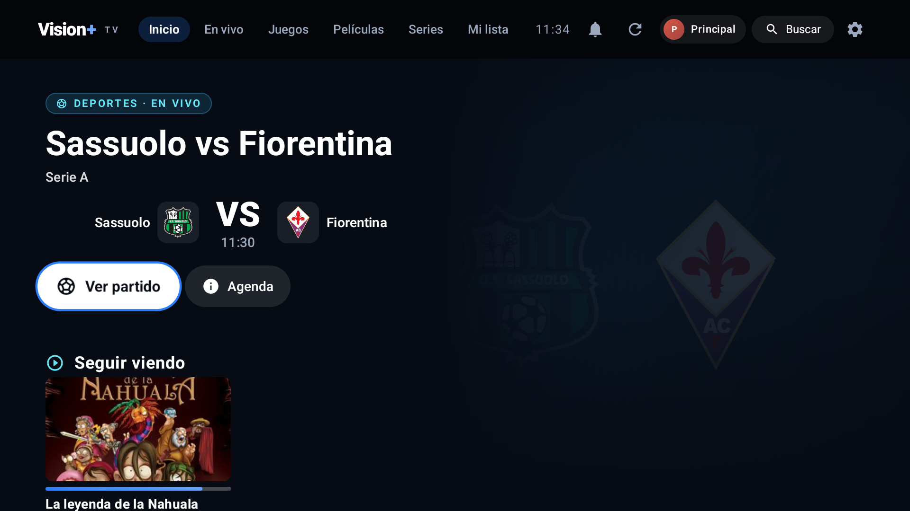
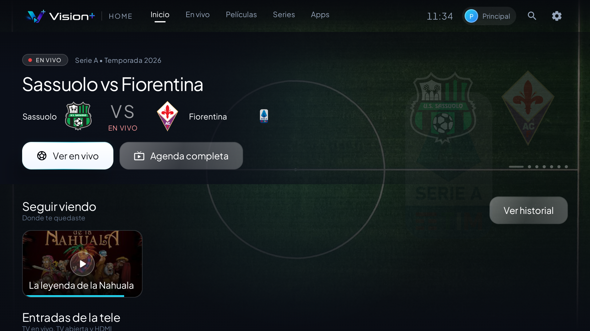

# Vision+

> **Aviso de migración:** las versiones anteriores a **2.6.3** quedarán descontinuadas el
> **9 de noviembre de 2026**. Actualiza a la última versión para seguir recibiendo
> actualizaciones. La 2.6.3 se instala encima sin perder datos.
>
> Descarga: [última versión](https://github.com/ChronosBVRX/Vision-Releases/releases/latest)

Canal oficial de distribución de **Vision+** para Android, Android TV y Google TV.

Aquí solo se publican las **compilaciones firmadas** y el manifiesto de actualización. El código
fuente, el backend y la documentación interna son privados.

## Descargar

- **Última versión estable:** [Releases → Latest](https://github.com/ChronosBVRX/Vision-Releases/releases/latest)
- **APK directo:** [VisionPlus.apk](https://github.com/ChronosBVRX/Vision-Releases/releases/latest/download/VisionPlus.apk)
- **Launcher para TV:** [VisionPlusHome.apk](https://github.com/ChronosBVRX/Vision-Releases/releases/latest/download/VisionPlusHome.apk)
- **PC portable:** [VisionPlusPC-Portable.exe](https://github.com/ChronosBVRX/Vision-Releases/releases/download/pc-latest/VisionPlusPC-Portable.exe)
- **LG webOS:** [visionplus-webos_0.3.0_all.ipk](https://github.com/ChronosBVRX/Vision-Releases/releases/download/v2.6.1/visionplus-webos_0.3.0_all.ipk)

## Capturas

| Android TV | Launcher |
|---|---|
|  |  |

## Requisitos

- Android 7.0 (API 24) o superior.
- Para TV: Android TV / Google TV con instalación de APK permitida.
- Para el launcher: Android TV / Google TV (opcional).

## Instalación

### Teléfono o tablet

1. Descarga `VisionPlus.apk`.
2. Permite instalar aplicaciones de esta fuente si el sistema lo pide.
3. Instala y abre Vision+.

### Android TV / Google TV

1. Descarga `VisionPlus.apk` desde el navegador del televisor o envíalo por USB / Downloader.
2. Activa «Instalar apps desconocidas» para la app que abre el archivo.
3. Instala Vision+.
4. Si quieres el Inicio propio de Vision+, instala también `VisionPlusHome.apk` y elige
   Vision+ Home como launcher predeterminado.

Las actualizaciones se conservan al instalar encima de la misma firma. No se pierden perfiles,
favoritos, historial ni descargas.

## Actualizaciones (OTA)

La app consulta este repositorio automáticamente:

- `version.json` — versión publicada.
- `VisionPlus.apk` — actualización de la app.
- `VisionPlusHome.apk` — actualización del launcher.

No hace falta descargar nada a mano: cuando hay una versión nueva, Vision+ la ofrece dentro de la
app.

## Canales

- **Estable:** release `latest`.
- **Beta:** tag `beta`, marcado como pre-release. Solo para equipos de prueba.

## Privacidad y seguridad

- [Política de privacidad](PRIVACY.md)
- [Seguridad](SECURITY.md)
- [Términos de uso](EULA.md)
- [Avisos de terceros](THIRD_PARTY_NOTICES.md)

## Licencia

El software distribuido en este repositorio es **propietario**. Todos los derechos reservados.
Consulta [LICENSE](LICENSE).

Vision+ incluye componentes de código abierto bajo sus propias licencias; esas licencias se
conservan en el APK y en sus avisos correspondientes.

## Aviso

Vision+ es un proyecto personal. No es una tienda de aplicaciones ni un servicio público de
streaming. Reproduce fuentes que el usuario configura o a las que tiene acceso.
